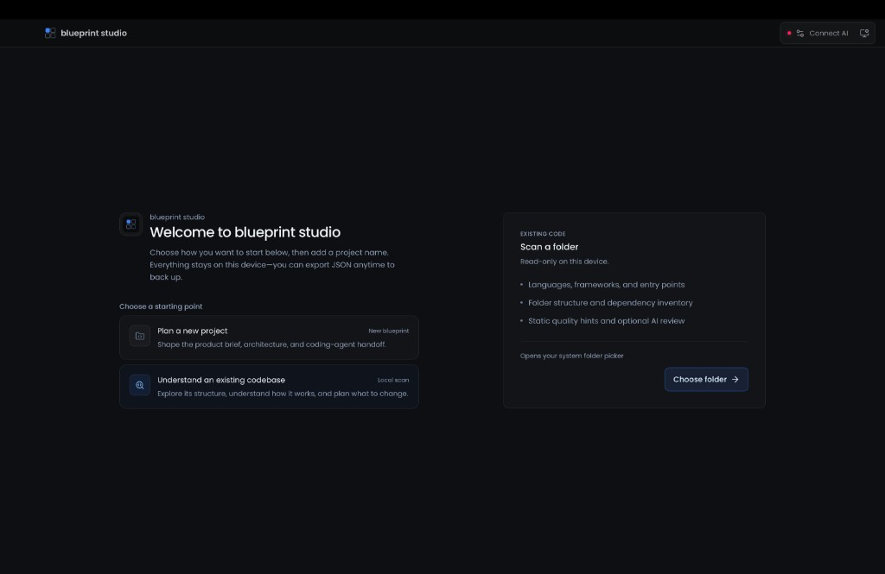
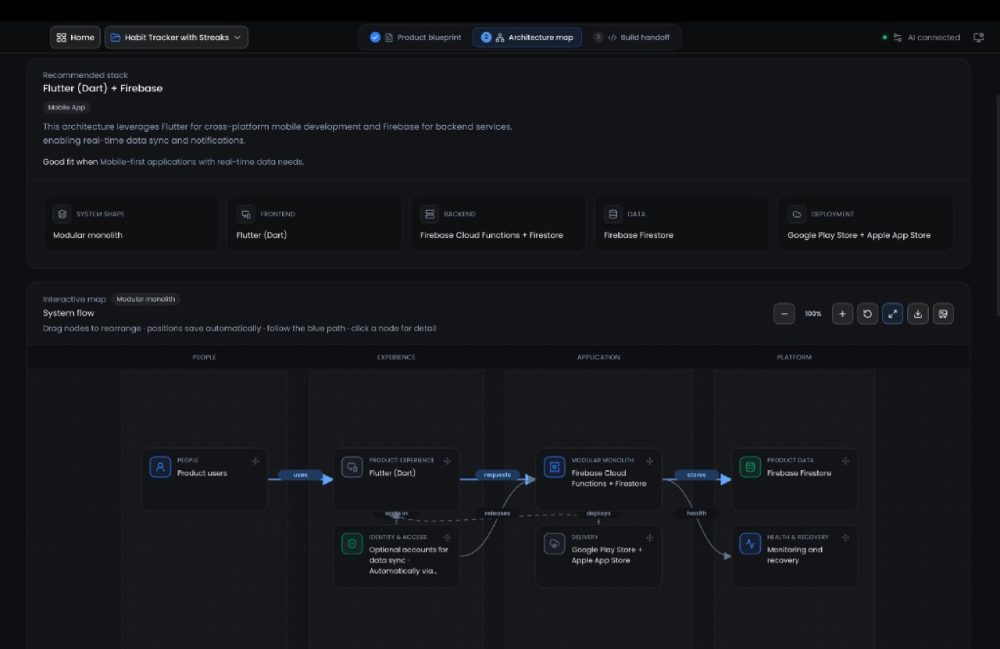
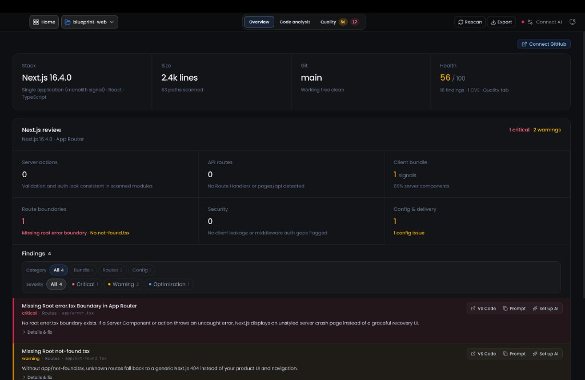

<p align="center">
	
</p>

<h1 align="center">blueprint studio</h1>

<p align="center">
	<strong>Plan before your AI agent builds. Scan what it already built.</strong>
</p>

<p align="center">
	Local studio for agent handoffs and codebase quality reports.<br>
	Specs and scans stay on your machine; AI calls go only to the provider you choose.
</p>

<p align="center">
	<a href="https://blueprint-web-chi.vercel.app/">Website</a>
	 ·
	<a href="https://github.com/KingAbe1/blueprint/releases">Download</a>
	 ·
	<a href="./docs/overview.md">Overview</a>
	 ·
	<a href="./CONTRIBUTING.md">Contributing</a>
	 ·
	<a href="https://github.com/KingAbe1/blueprint/discussions">Discussions</a>
</p>

<p align="center">
	<a href="https://github.com/KingAbe1/blueprint/releases/latest">
		
	</a>
	<a href="./LICENSE">
		
	</a>
</p>

| Plan a new product | Architecture map | Scan an existing repo |
| :---: | :---: | :---: |
|  |  |  |

Works in the **browser** or as a **desktop app** (Tauri). Use desktop for reliable folder access and writing handoffs to disk. There is no hosted backend for your projects.

## Why blueprint studio

- **Plan, then hand off.** Product brief → build questions → architecture map → editable agent handoff for Cursor, VS Code, Claude Code, Codex, JetBrains, and similar tools.
- **Scan what you already have.** Overview, tree, dependencies, scripts, health score, CVEs, and optional AI review on files you choose.
- **Framework-aware depth.** Deep profiles for Next.js, Remix, Expo / React Native, and Node.js (Express / Fastify / Koa / Hono / Nest / http).
- **Open in your editor.** Jump from findings to file and line in your preferred IDE (Cursor, VS Code, Windsurf, JetBrains, Zed, Sublime).
- **Your AI, your keys.** Optional providers (OpenAI, Anthropic, Gemini, Ollama, OpenRouter, Groq, DeepSeek, Mistral, xAI, Together, or a custom base URL). Requests go to your provider; blueprint studio does not proxy them.
- **Local by default.** Specs and scans stay on disk. AI calls go only to the provider you configure. No cloud sync of your projects.

## Get started

For most users, the fastest path is:

1. Download an installer from [Releases](https://github.com/KingAbe1/blueprint/releases).
2. Open blueprint studio and create a project or scan a folder.
3. For greenfield AI steps, configure a provider in Settings.
4. Export a handoff zip, write files to disk, or browse findings and open them in your IDE.

**Note:** macOS builds are not Apple-notarized yet. After install you may need a one-line Terminal fix (details below the table).

| Platform | File to use |
| --- | --- |
| macOS Apple Silicon | `.dmg` with `aarch64` in the name |
| macOS Intel | `.dmg` with `x64` in the name |
| Windows | `.msi` or NSIS installer |
| Linux | `.deb` or `.AppImage` |

### macOS: “damaged and can’t be opened”

After dragging the app to **Applications**:

```bash
xattr -cr "/Applications/blueprint studio.app"
```

Then open the app again (or right-click → **Open**). That clears the download quarantine flag; the app is not actually damaged.

You can also try the web app at [blueprint-web-chi.vercel.app](https://blueprint-web-chi.vercel.app/). Desktop is recommended for folder scans and handoff export to disk.

## Local development

blueprint studio is a Vite + React frontend with a Tauri 2 desktop shell (Rust).

Requirements:

- Node.js 22 or newer (CI uses 22)
- Rust stable (for desktop)
- npm

```bash
npm install
npm run dev          # browser — http://localhost:5173
npm run tauri:dev    # desktop (alias: npm run app)
npm run tauri:build  # local installers
npm run build        # frontend only
```

On macOS, `./launch-desktop.sh` opens the web UI in a standalone browser window.

Publishing a tag like `v1.1.3` triggers the [desktop release](https://github.com/KingAbe1/blueprint/releases) workflow for macOS, Windows, and Linux.

## Repository map

| Path | What lives there |
| --- | --- |
| `src/` | React UI, services, framework analyzers |
| `src/services/frameworks/` | Deep brownfield profiles (Next.js, Remix, Expo, Node) |
| `src-tauri/` | Tauri shell, IDE open, folder I/O, handoff export |
| `docs/` | Contributor overview and notes |
| `.github/workflows/` | Desktop build and release |

## Privacy

- Specs and scan results stay local. Export/import JSON from the project menu to back up.
- Scans read files on disk; they are not uploaded to us.
- GitHub / npm advisory features only use credentials or lockfile data you already opted into.

## Contributing

Issues, pull requests, docs fixes, and new framework profiles are welcome.

Looking for a place to start? See issues labeled [`good first issue`](https://github.com/KingAbe1/blueprint/issues?q=is%3Aissue+is%3Aopen+label%3A%22good+first+issue%22). Questions and ideas belong in [Discussions](https://github.com/KingAbe1/blueprint/discussions).

- Read [CONTRIBUTING.md](./CONTRIBUTING.md) before opening a pull request.
- See [docs/overview.md](./docs/overview.md) for how the app is wired (contributor notes).
- [CODE_OF_CONDUCT.md](./CODE_OF_CONDUCT.md) and [SECURITY.md](./SECURITY.md) apply.

## License

[MIT](./LICENSE). Fork, modify, and ship your own product (keep the license notice).

The name **blueprint studio** and [blueprint-web-chi.vercel.app](https://blueprint-web-chi.vercel.app/) are the maintainer’s product. Forks are welcome; please use a different name and branding so users know who they are getting software from.
